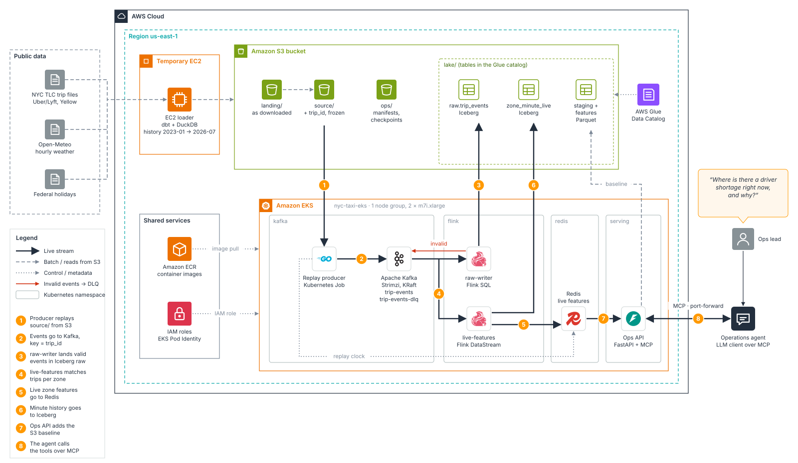

# Agent-Ready Real-Time Platform

A real-time data platform built on NYC Uber/Lyft trip records. It turns every
trip into a stream of events, computes per-zone metrics every minute, and
serves them to an operations agent that answers questions like *"Where are
riders waiting longest right now, and is it unusual?"*

An agent is only as good as the data underneath it. Most of this project is
that data layer: clean events, a per-zone definition of "normal", and tools
that return sourced, comparable numbers.

## How data flows

1. A Go producer replays NYC TLC trip files from S3 on a replay clock. Each
   trip becomes four events: requested, driver arrived, picked up, dropped off.
2. Events go to Kafka, keyed by trip, so a trip's events stay in order.
3. A Flink SQL job writes every valid event to an Iceberg table, exactly once.
   Malformed events go to a dead-letter topic with a reason.
4. A Flink DataStream job matches each trip's events and aggregates them per
   zone and provider every minute: requests, median and p90 wait (request to
   driver arrival), open requests and the age of the oldest one.
5. The latest values go to Redis for serving.
6. The same records are appended to an Iceberg minute log, so any past minute
   can be read back exactly as it was served.
7. The Ops API combines live values with batch history from dbt: the normal
   wait for this zone, weekday and hour, and how unusual the current wait is
   against the zone's own last 8 weeks.
8. The agent reaches the data only through the API's read-only MCP tools.

## Data

| | |
|---|---|
| Source | NYC TLC High Volume FHV (Uber, Lyft), 2023-01 to 2026-09 |
| Raw events | 3.48 billion in Iceberg |
| Trips | 863 million after staging |
| Zones | 263 NYC taxi zones |
| Context | Hourly weather (Open-Meteo), federal holidays |

History up to 2026-07 is loaded as a batch backfill into the same raw table the
stream writes to, so batch and live use one event model. 2026-08 and 2026-09
are replayed live.

## What "normal" means

- **Normal wait:** the median wait for the same zone, provider, weekday and
  NYC hour over the previous 6 weeks. Holidays and hours with too few trips
  are left out. The 6-week window was chosen by backtesting 1 to 12 weeks.
- **Unusual:** zones swing by different amounts, so there is no fixed
  threshold. The current ratio to normal is ranked against the zone's own
  hourly ratios from the last 8 weeks; the 95th percentile or above is unusual.

## The operations agent

The agent runs in an LLM client connected over MCP. It has no file, shell or
web access; its only tools are these:

| Tool | Answers |
|---|---|
| `now` | The replay time and whether live data is current |
| `resolve_place` | Which zones a place name covers ("Midtown", "JFK") |
| `find_shortages` | Zones ranked by unusual wait, oldest open request, or requests vs normal |
| `get_city_summary` | Each borough and the whole city against normal |
| `get_zone_now` | One zone right now, next to its normal |
| `get_zone_history` | One zone minute by minute over the last hours |
| `get_catalog` | What the data can and cannot answer |
| `describe_metric` | Definitions and units |

Every response carries the unit, the moment it describes, its freshness, the
sample size, the baseline it was compared with, and caveats. Questions the data
cannot answer, such as driver counts, cancellations or surge multipliers, are
declined instead of estimated.

## Evaluation

`evals/` holds 23 questions written the way an ops manager asks them, at three
fixed moments, including bait questions that look answerable but are not.

- The API can be frozen at any past minute (`FROZEN_NOW`); live values then
  come from the Iceberg minute log, so runs are reproducible.
- The answer key is computed separately in SQL from the tables, not through
  the API. At all three moments it matches the API's output.
- Each run records every tool call and output. Grading checks that every
  number in an answer appears in a tool output, then a second model judges
  each answer against the key.

## Infrastructure

- Amazon EKS with one node group, defined in Terraform. Kafka runs on Strimzi,
  Flink on the Flink Kubernetes Operator.
- One IAM role per service through EKS Pod Identity, each limited to the S3
  prefixes and tables it needs. The API role can only read.
- Redis ACLs: the producer may only write the replay clock, the API may only read.
- Terraform state in S3 with native locking.
- The node group scales to zero when not in use.

## Stack

AWS (EKS, S3, ECR, IAM, Glue) · Terraform · Kubernetes · Go · Apache Kafka ·
Apache Flink · Apache Iceberg · Redis · dbt · DuckDB · Python · FastAPI · MCP

## Repository layout

| Path | Contents |
|---|---|
| `*.tf` | AWS infrastructure |
| `ingest/` | Loading source files and the event backfill |
| `producer/` | Go replay producer |
| `flink/` | Flink jobs: raw writer and live features |
| `features/` | Live feature definitions |
| `transform/` | dbt models: staging, features, baselines |
| `serving/` | Ops API (HTTP and MCP) |
| `agents/` | Operations agent role and permissions |
| `evals/` | Questions, answer key, runner and grader |
| `analysis/` | One-off analyses (rain vs wait times) |
| `k8s/` | Kubernetes manifests |
